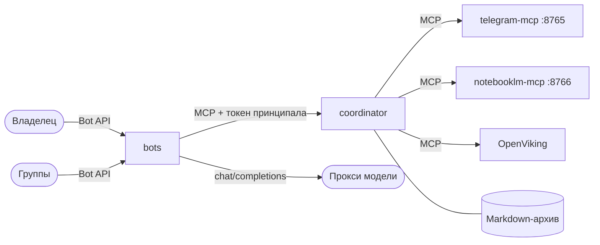

# Архитектура

Telegram Memory — личный архив публикаций Telegram, собственных заметок и веб-страниц с поиском и ответами по источникам. Архив хранится в Markdown и не зависит от поискового индекса: индекс OpenViking всегда можно перестроить из архива.

## Контейнеры

Постоянных контейнеров четыре. Порты наружу не публикуются, контейнеры общаются по отдельным внутренним сетям.

| Контейнер | Что делает | Сети | Память / CPU |
|---|---|---|---|
| `coordinator` | Архив, сбор Telegram, приём веб-страниц, проекция в OpenViking, доступ по принципалам, сводки, оповещения. MCP-сервер на `:8787/mcp` | `bots_coord`, `coordinator_telegram`, `coordinator_openviking` | 640 МиБ / 0,35 |
| `bots` | Приёмщик и Собеседники в одном процессе. Тот же образ, что у координатора, с точкой входа `src/bots/main.ts` | `bots_coord` | 512 МиБ / 0,25 |
| `telegram-mcp` | Два MCP-сервера: `telegram-mcp` поставщика на `:8765` (чтение Telegram от имени учётной записи владельца) и `notebooklm-mcp` на `:8766` (длинные сводки) | `coordinator_telegram` | 512 МиБ / 0,35 |
| `openviking` | Поисковый индекс, без изменений поставщика | `coordinator_openviking` | 1600 МиБ / 1 |

Боты не видят Telegram-сессию, ключ OpenViking и архив: у них есть только сеть до координатора. Координатор — единственный, кто пишет в архив.

## Тома

| Том | Контейнер | Содержимое |
|---|---|---|
| `archive_data` | coordinator | Markdown-архив: `/data/archive` |
| `coordinator_state` | coordinator | SQLite: источники, задания, очередь проекции, доступ групп, оповещения |
| `coordinator_reports` | coordinator | Отчёты |
| `exchange_data` | coordinator, telegram-mcp | Передача вложений из Telegram: `/exchange` |
| `telegram_data` | telegram-mcp | Сессия Telegram и состояние `nlm` (куки NotebookLM) |
| `openviking_data` | openviking | Индекс; восстанавливается из архива |

## Области памяти

Область записи выводится из её пути в архиве, а не из того, что просит модель.

- **Общая** — `telegram/channels/…` и `telegram/groups/…`: каналы и группы полного сбора.
- **Личная** — `personal/<владелец>/…`: заметки, веб-страницы, пересылки и личные переписки.

Группы в режиме «только сводка» в архив не пишутся. Правила доступа к областям описаны в [API координатора](coordinator-api.md).

## Роли

- **Приёмщик** — бот владельца без модели, через него идёт вся запись. Сохраняет присланное, подключает источники, управляет доступом групп.
- **Собеседник** — бот с моделью и ровно двумя средствами: поиск и чтение. Экземпляров может быть несколько: «мой» (только владелец, вся память, сводки) и «общий» (группы, только общая память в пределах, разрешённых владельцем).
- **system** — служебный принципал для агента владельца и отладки: управление сбором, поиск, сохранение.

Подробно — в [описании ботов](bots.md).

## Каталоги репозитория

| Каталог | Что лежит |
|---|---|
| `src/` | Код координатора: архив (`archive.ts`), доступ (`access.ts`), MCP-средства (`coordinator.ts`), разбор входящего (`inbox.ts`), сводки (`digest.ts`), NotebookLM (`notebook.ts`), интеграции и веб-приём (`integrations.ts`, `clipper.ts`) |
| `src/server/` | Сетевой слой координатора: HTTP-сервер MCP, адаптеры OpenViking и Telegram, безопасная загрузка страниц |
| `src/bots/` | Процесс ботов: цикл Bot API, Приёмщик, Собеседник, сводки по расписанию |
| `test/` | Тесты `node --test` на подделках внешних служб |
| `docker/` | Dockerfile координатора и производного telegram-mcp, точка входа telegram-mcp, сборка API Clipper |
| `scripts/` | Скрипты развёртывания bash: настройки, секреты, обновление, проверка состава |
| `config/` | Перечень поставщиков, каталог секретов, преднастройки OpenViking (без значений секретов) |
| `VERSION` | Номер релиза |
| `docs/` | Эта документация |

Каталог `vendor/` в репозиторий не входит: там лежат локальные копии исходников поставщиков для справки. Сборка их не использует — исходники берутся из git по закреплённым коммитам (см. [развёртывание](deployment.md)).
